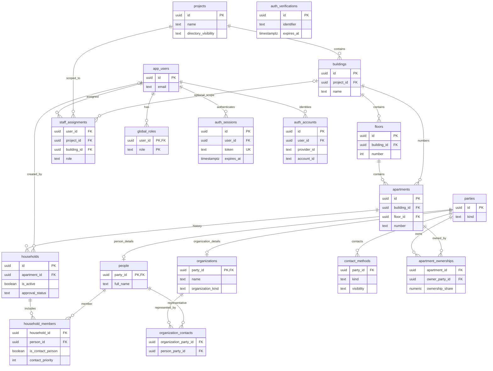

# Neighborly Hub

אפליקציה קהילתית לניהול ספר שכנים, פרטי קשר וימי הולדת של דיירים בבניינים ובמתחמים.

## Current status

The project uses **Next.js 15 App Router**, PostgreSQL and Drizzle. Google sign-in, database sessions, explicit resident identity links and server-side directory privacy are implemented. `/directory` reads authorized live data after sign-in; household details, join and management routes remain synthetic previews. Configure [authentication](docs/authentication.md), apply migrations 0001–0004 and provision verified links before testing the live directory. The legacy Lovable/TanStack runtime has been removed.

## Getting started

Requires Node.js 24 (see `.nvmrc`) and pnpm 10.18.3.

```bash
nvm install
nvm use
corepack enable
pnpm install
pnpm dev
```

Open http://localhost:3000. `/directory` requires configured authentication; component previews remain available in Storybook without secrets.

## Routes

- `/` — landing page
- `/directory` — protected live directory, authorized project/building selection, server search and pagination
- `/api/directory/projects` — authorized project/building metadata
- `/api/projects/:projectId/directory` — private paginated adult resident DTOs
- `/household/1` — example household details
- `/join` — demo registration form (no persistence)
- `/manage` — demo management interface
- `/auth` — Google sign-in when configured; `/reset-password` redirects here
- `/account` and `/api/me` — protected current-user profile

## Development and code quality

ESLint 9 checks code quality, and Prettier 3 handles formatting independently. Configurations: `eslint.config.js`, `.prettierrc`, and `.prettierignore`.

```bash
pnpm typecheck       # TypeScript
pnpm lint            # ESLint
pnpm test            # Vitest unit tests
pnpm test:watch      # Watch mode for unit tests
pnpm format:check    # Check formatting
pnpm format          # Apply formatting
pnpm build           # Production build
```

CI runs installation, an incremental Prettier check for changed source files, typecheck, lint, unit tests and build. Existing unformatted files are not checked until changed; run `pnpm format` to format the whole project when ready.

## Localization

Hebrew (RTL), English (LTR), and Russian (LTR) are supported. Both client-side UI and server-generated metadata use `src/lib/i18n/dictionary.ts`. Language preference is saved in the `neighborly_lang` cookie and controls document `lang` and `dir`. Hebrew is the default.

## Product requirements

דרישות המערכת והאפיון:

1. מובייל פירסט (Mobile-first) בעיצוב חם, קהילתי וידידותי, עם תמיכה מלאה בשלוש שפות: עברית (RTL), אנגלית (LTR), ורוסית (LTR).
2. הוספת פרויקט ובניינים: הגדרת בניין עם מספר קומות ומספר דירות בכל קומה, עם מחולל אוטומטי של דירות.
3. כרטיס דירה ותא משפחתי:
   - הבחנה ברורה בין סוגי החזקה: בעלים ומתגורר (גם וגם), שוכר (דייר בפועל), או בעל דירה שאינו מתגורר.
   - תמונת פרופיל/אוואטר למשפחה או לדייר.
   - איש קשר ראשי + ניהול רשומת בני משפחה (תתי אנשי קשר). בני משפחה (כמו ילדים) לא חייבים מספר טלפון.
   - תאריכי לידה/גיל לכל בן משפחה, ווידג'ט לחגיגות ימי הולדת קרובים בבניין/במתחם.
   - ריבוי מספרי טלפון ואימיילים לאיש קשר.
   - כפתורי פעולה מהירה ונוחה במובייל: חיוג ישיר (tel:), וואטסאפ ישיר (wa.me), ושליחת מייל (mailto:) ישירות מהכרטיס.
4. מודל הרשאות:
   - מנהל מערכת (יצירת פרויקטים).
   - מנהל פרויקט (ניהול מתחם של מספר בניינים, כגון בלוק של 8 בניינים כמו "המושבה העירונית שדרות").
   - מנהל בניין / ועד בית.
   - דייר.
5. תהליך רישום ואישור דיירים:
   - קישור/טופס הצטרפות ידידותי במובייל (בחירת בניין ודירה, הזנת שמות ופרטי קשר).
   - בקשות הצטרפות ממתינות לאישור מנהל הבניין/פרויקט, ומוצגות בספר השכנים רק לאחר אישור.
6. הגדרות נראות ופרטיות:
   - מנהל הפרויקט יכול להגדיר האם ספר השכנים ולוח ימי ההולדת גלויים לכלל הבניינים במתחם (נראות קהילתית פתוחה) או מוגבלים לכל בניין בנפרד.
   - אפשרות לדייר לקבוע לכל מספר טלפון האם הוא גלוי לכלל המתחם, לשכנים בבניין בלבד, או למנהלים בלבד (פרטי). מספרי טלפון של ילדים מוגנים כברירת מחדל למנהלים בלבד.

## Database structure

The planned PostgreSQL schema is defined in [Drizzle schema](drizzle/schema.ts), with the currently authoritative [SQL baseline](database/migrations/0001_initial.sql). The diagram below is maintained manually alongside schema changes; it is **not generated automatically**. Lines represent foreign-key relationships, except that the two composite foreign keys are explained below.



**Contact ordering:** `household_members.contact_priority` controls the order of designated contacts (lower number first; ties are allowed). Only members with `is_contact_person = true` are designated contacts. There is no separate member sort order. The database does not currently enforce that non-contact members have a null priority.

**Key constraints:** Each building can have different numbers of apartments on each floor. Apartment numbers are unique per building. At most **one active household** is allowed per apartment (historic inactive households can remain). A person or organization can own multiple apartments, and an apartment can have multiple owners. Multiple members of a household may be designated contact persons.

**Composite constraints in SQL:** `apartments(floor_id, building_id)` must refer to the same `floors(id, building_id)`; `staff_assignments(building_id, project_id)` must refer to `buildings(id, project_id)`. These are currently enforced in the SQL baseline and not yet expressed in the Drizzle TypeScript schema. Party/subtype consistency is enforced by migration 0002.

For setup and migration caveats, see [Database README](database/README.md) and [Drizzle integration](docs/drizzle-integration.md).

## Next steps

The authenticated directory is connected to server-authorized data. Next: scoped manager workflows for joining, verifying resident links and approving households. Household details, editing, birthdays and organization directories require dedicated authorized endpoints; their existing previews are not live-data features.

Resident identity provisioning, deployment prerequisites and revocation behavior are documented in [resident authorization](docs/resident-authorization.md). Screenshots remain on demand only.

See [Live management workspace](docs/management-workspace.md) for authenticated project discovery, structural browsing and management authorization.
