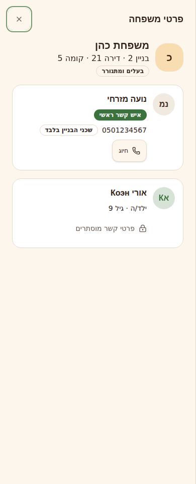
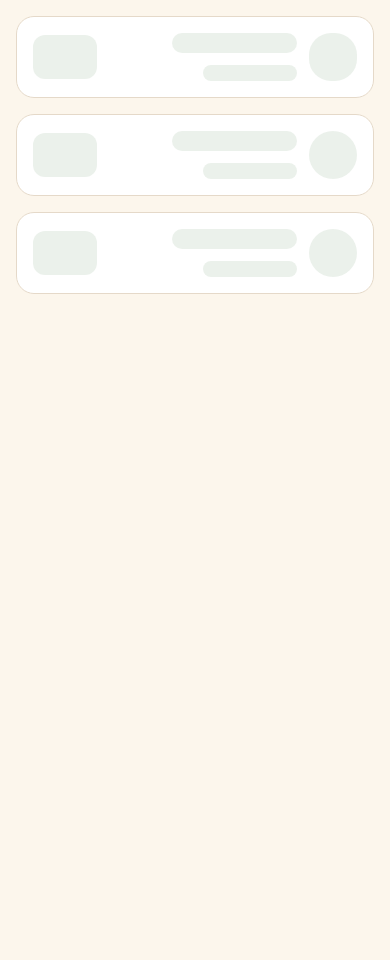
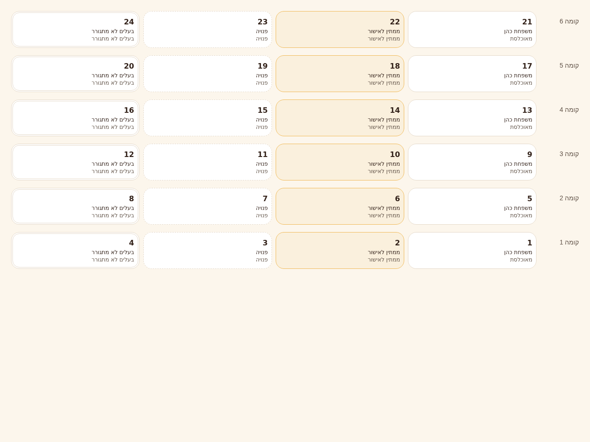

# PR #21 — Storybook review screenshots

Real Chromium captures of synthetic Storybook fixtures. These show individual building blocks and compositions, not completed application screens. Source stories: `883c3f0`; captures wait for fonts and finite entry animations to finish.

| Preview                | Locale and viewport | Image                                   |
| ---------------------- | ------------------- | --------------------------------------- |
| Household row          | Hebrew · 390px      | [PNG](01-household-he-mobile.png)       |
| Privacy selector       | Hebrew · 390px      | [PNG](02-privacy-he-mobile.png)         |
| Member editor          | Russian · 390px     | [PNG](03-member-form-ru-mobile.png)     |
| Apartment map          | Hebrew · 1280px     | [PNG](04-apartment-map-he-desktop.png)  |
| Directory filters      | English · 1280px    | [PNG](05-directory-en-desktop.png)      |
| Child privacy defaults | Hebrew · 390px      | [PNG](06-child-privacy-he-mobile.png)   |
| Manager navigation     | Russian · 390px     | [PNG](07-navigation-ru-mobile.png)      |
| Details skeleton       | Hebrew · 390px      | [PNG](08-loading-details-he-mobile.png) |
| Building map skeleton  | English · 1280px    | [PNG](09-loading-map-en-desktop.png)    |
| Full-width details     | Hebrew · 390px      | [PNG](10-details-he-mobile.png)         |
| Side sheet             | English · 768px     | [PNG](11-details-en-tablet.png)         |
| Inline detail panel    | English · 1280px    | [PNG](12-details-en-desktop.png)        |

## Mobile details and loading

## Apartment map

Future CI runs upload fresh captures as the `storybook-screenshots` artifact. This gallery is a fixed review snapshot; it is not a pixel comparison baseline.
