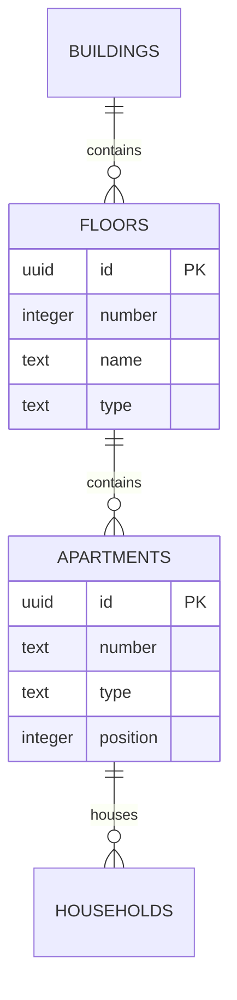

# Project Structure Wizard 2b: design analysis and migration

## Product model inferred from the supplied mockups

The wizard mockup specifies the structure step of a four-step flow. The Components and Screens references supply the existing warm surfaces, green actions, soft status colors, logical spacing, bidirectional text and three-language behavior. The pink explanatory strip and numbered annotations describe a mockup demonstration; they are not production content or data.

The central domain decision is that a unit's business label (`25B`, `Studio-X`, `PH-1`) is independent of its ordinal position. A drag changes order, not identity or name. Floor level is also separate from its optional display name. Unit types describe residential, commercial or parking use; they do not create separate parallel hierarchies. Empty floors of any type remain valid. A floor's type supplies the default for new units, while each existing unit may retain a different type.

| Mockup behavior                    | Implementation                                                                                                     |
| ---------------------------------- | ------------------------------------------------------------------------------------------------------------------ |
| Four steps                         | Project details → structure → types → review/create                                                                |
| Building/floor hierarchy           | Shared `ProjectStructureEditor`, collapsible cards and compact inline unit chips                                   |
| Direct editing                     | Click label, Enter or blur to commit, Escape to cancel                                                             |
| Order independent of name          | Unit array order → persisted `position`; IDs/labels stay stable during moves                                       |
| Drag between floors                | Within one building; explicit earlier/later and target-floor controls also support keyboard/touch                  |
| Search and type filters            | Building, floor name/level and unit labels; counts always describe the full draft                                  |
| Empty commercial/parking floors    | Typed empty/drop areas with an add-unit action; no artificial placeholder units                                    |
| Bulk creation                      | Duplicate floors above a source, shift higher levels, preview counts, confirm before applying                      |
| Copy into existing floors          | Preview replacement, retain linked units, allocate new unique labels; no copied relationships                      |
| Copy across buildings during setup | Explicit target selection in a dialog; replace only selected layouts with fresh IDs, retain target names/addresses |
| Project summary                    | Derived building/floor/unit counts, type percentages and selected building section                                 |
| Compare buildings                  | Horizontally scrollable table with rows aligned on numeric floor level                                             |
| Validation                         | Shared client/server bounds and normalized duplicate detection; review cannot continue while invalid               |
| Linked units                       | Visible indicator and disabled destructive actions; fresh server reference checks protect all writes               |
| Draft persistence                  | Versioned device-local setup draft, explicit restore, save errors and cross-tab conflict handling                  |
| Existing project editing           | Same editor, authorized building snapshot save, optimistic version check and atomic transaction                    |

## Deliberate decisions

- No new state-management or drag-and-drop dependency. Native dragging has equivalent button/select controls for non-drag input.
- New copied units receive unique labels. Existing labels are never silently renumbered when levels shift: changing a business identifier could invalidate external references. This differs from the mockup's suggested automatic `201 → 301` renumbering and follows its stronger requirement that label and position remain separate.
- Setup autosave is device-local and explicitly labeled. Creating a server draft would add a new lifecycle and retention policy. Existing buildings keep explicit server save, with stale/uncertain outcomes requiring reload rather than an automatic overwrite.
- The types step exposes only fields actually supported by the design/domain. No speculative unit specifications, publishing state, resident membership or role changes are introduced.
- Existing multi-building count editing remains available alongside the detailed editor.

## Data and compatibility

Apply authoritative SQL migration `0008_structure_editor.sql` through the existing checksummed migration runner. It adds `floors.name`, `floors.type`, `apartments.type`, and nonnegative `apartments.position`. Existing units remain residential and receive deterministic positions, without changing names, UUIDs, relationships or household records. Types have PostgreSQL CHECK constraints. Positions are display preferences and need not be globally unique; explicit saves write a contiguous order per floor, and readers use stable tie-breakers.

The authenticated setup endpoint keeps compact `floors`/`unitsPerFloor`/`floorUnits` requests and accepts an explicit `structure` array. A detailed request must have a matching floor count and cannot mix in `floorUnits`. Both formats create the full hierarchy in one transaction. Setup and detailed PUT bodies are streamed and bounded at 12 MiB to support 10,000 long Unicode labels; entity counts and string lengths remain independently bounded.

`PUT /api/management/projects/:projectId/structure` additionally accepts a single detailed building snapshot with UUIDs and an `expectedVersion`. The original multi-building count contract remains supported. Authorization uses the verified session, exact origin, locked grants and the existing building scope locks. The service locks the current structure, checks its version, rejects deleting units referenced by households, ownership, invitations or join requests, and updates the building in one transaction. Rename/move preserves linked unit UUIDs. New UUIDs cannot overwrite another building's records. Temporary labels/levels permit swaps without violating unique constraints; failures roll back intermediate changes.

The version includes persisted labels, types, floor names and order. Linked status is queried afresh and never trusted from a client flag. Read-only relationship metadata is not part of a write payload.

## Verification

Unit/component coverage includes multilingual creation, server-error retention, duplicate submission protection, inline cancellation, normalized duplicates, local restore/storage errors/tab conflicts, stable move identities, linked-unit retention and floor duplication. PostgreSQL integration coverage exercises explicit setup/readback, swaps, stale versions, denied scopes and linked household deletion/moves. The integration suite runs in the existing isolated PostgreSQL CI job. Pilot browser smoke now follows the four-step wizard, and opt-in Storybook captures include the detailed editor in Hebrew, English and Russian at mobile/desktop sizes.
